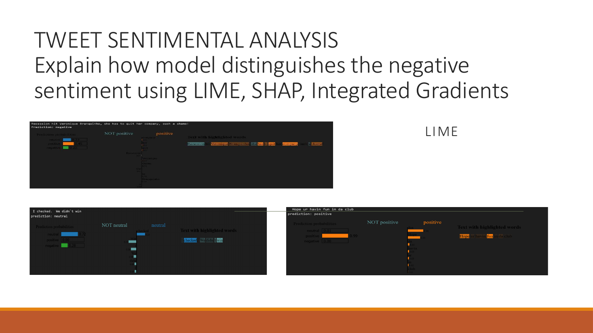
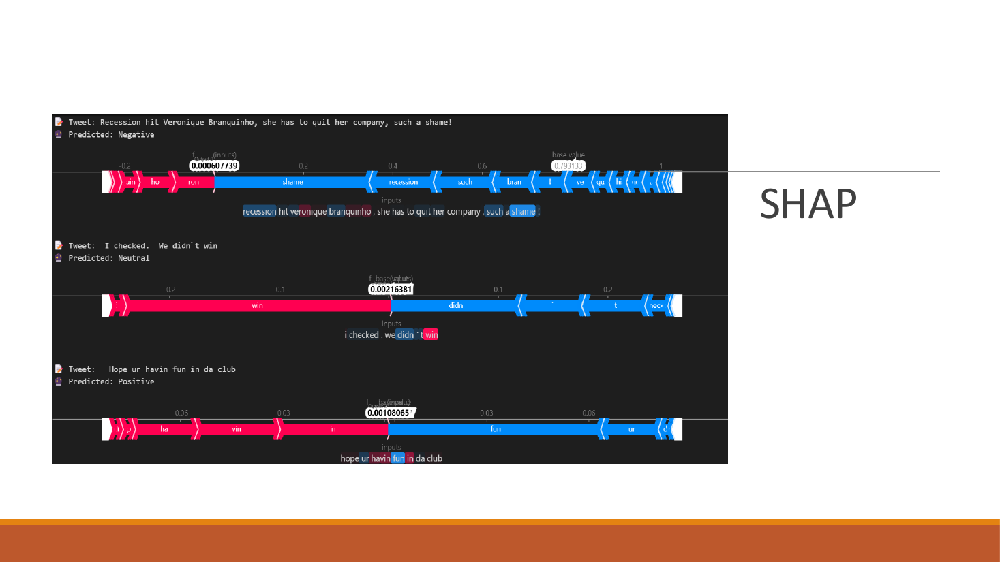
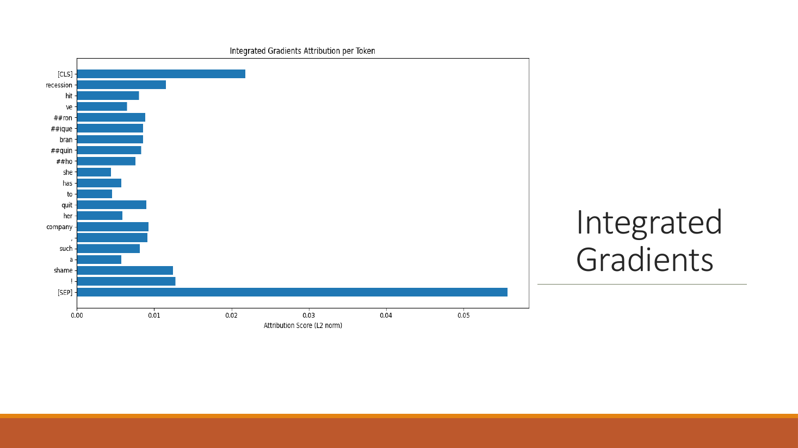
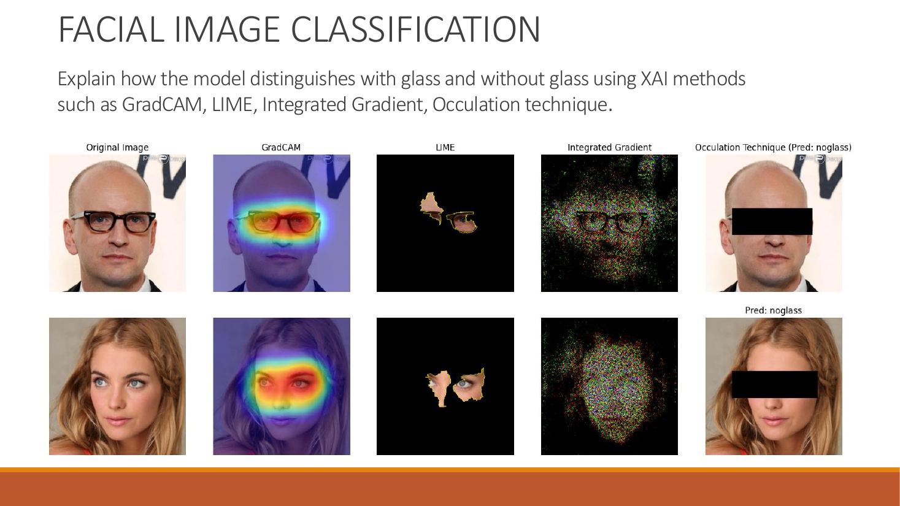
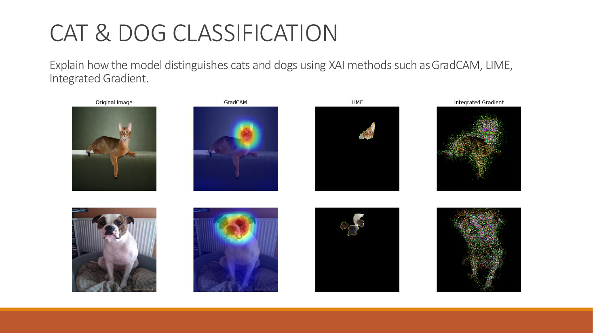

# Explainable AI (XAI) for Text and Image Classifiers

An M.Sc. Data Science team project (Team **TraceIt**, Philipps-Universität Marburg) that opens up "black-box" deep learning models. We applied several explainability methods to one text classifier and two image classifiers, to show **which words or image regions drive each prediction**, and compared what the different methods reveal.

## Overview

| Task | Model | Performance | XAI methods | Notebook |
| --- | --- | --- | --- | --- |
| Tweet sentiment analysis (negative / neutral / positive) | BERT (`bert-base-uncased`), fine-tuned | Test accuracy 0.78, F1 0.78 (3,534 tweets) | LIME, SHAP, Integrated Gradients | [01_tweet_sentiment_bert.ipynb](01_tweet_sentiment_bert.ipynb) |
| Facial image classification (with / without glasses) | ResNet-18, fine-tuned | F1 0.997 (validation) | Grad-CAM, LIME, Integrated Gradients, Occlusion | [02_facial_glasses_resnet.ipynb](02_facial_glasses_resnet.ipynb) |
| Cat vs dog classification | ResNet-18, fine-tuned | Test F1 0.99 (740 images) | Grad-CAM, LIME, Integrated Gradients | [03_cat_dog_resnet.ipynb](03_cat_dog_resnet.ipynb) |

Each dataset was split into 75% training, 15% validation and 10% test data.

## 1. Tweet sentiment analysis (BERT)

A pre-trained `bert-base-uncased` model was fine-tuned for 3-class sentiment classification with AdamW (learning rate 2e-5) for 5 epochs, reaching a test accuracy and F1 score of 0.78.

**Goal:** explain how the model tells negative sentiment apart from neutral and positive.

- **LIME** highlights the words that push a tweet towards or away from each class.
- **SHAP** shows the contribution of each token relative to the base value.
- **Integrated Gradients** gives an attribution score per token.

For the tweet *"Recession hit Veronique Branquinho, she has to quit her company, such a shame!"* (predicted **negative**), all three methods agree that words such as **"shame"** and **"recession"** are among the strongest drivers of the negative prediction.

## 2. Facial image classification: glasses vs no glasses (ResNet)

A pre-trained ResNet-18 was fine-tuned with Adam (learning rate 1e-4), reaching an F1 score of 0.997 on the validation set.

**Goal:** check that the model looks at the right region of the face.

- **Grad-CAM** heatmaps concentrate on the **eye region**, where glasses would appear.
- **LIME** keeps only the superpixels around the eyes and glasses.
- **Integrated Gradients** traces the outline of the glasses.
- **Occlusion:** when the eye region is covered, the model predicts **"no glass"**. This confirms that its decision depends on that area.

## 3. Cat vs dog classification (ResNet)

A pre-trained ResNet-18 was fine-tuned with Adam (learning rate 1e-4) for 3 epochs, reaching an F1 score of 0.99 on 740 test images.

**Goal:** see which features the model uses to separate cats from dogs.

Grad-CAM and LIME both focus mainly on the **animal's head and face**, rather than on the background. Integrated Gradients outlines the animal's body shape.

## Key takeaways

- Different XAI methods often **agree on the most important evidence** (for example the eye region for glasses, or the word "shame" for negative sentiment), which increases trust in the explanation.
- **Perturbation-based methods** (LIME, occlusion) and **gradient-based methods** (Grad-CAM, Integrated Gradients) complement each other: one tests what happens when evidence is removed, the other shows where the model's gradients concentrate.
- XAI is a practical way to **validate that a model relies on meaningful features** rather than on background artefacts.

## Repository structure

| File | Contents |
| --- | --- |
| `01_tweet_sentiment_bert.ipynb` | BERT tweet sentiment model with LIME, SHAP and Integrated Gradients |
| `02_facial_glasses_resnet.ipynb` | ResNet-18 glasses classifier with Grad-CAM, LIME, Integrated Gradients and occlusion |
| `03_cat_dog_resnet.ipynb` | ResNet-18 cat vs dog classifier with Grad-CAM, LIME and Integrated Gradients |
| `*.png` | Explanation figures used in this README |
| `requirements.txt` | Python dependencies |

## How to run

1. Install the dependencies: `pip install -r requirements.txt`
2. Datasets are not included in this repository. Place them as the notebooks expect:
   - Tweets: `train.csv` and `test.csv` in the notebook folder
   - Glasses: `glasses/data/{train,val,test}/<class>/` image folders
   - Cats and dogs: `data/{train,val,test}/<class>/` image folders
3. Open the notebooks in Jupyter or Google Colab (a GPU is recommended).

## Tech stack

Python · PyTorch · Hugging Face Transformers · torchvision · Captum (Integrated Gradients) · LIME · SHAP · pytorch-grad-cam · scikit-learn · OpenCV · scikit-image · pandas · NumPy · matplotlib

## Team

Team TraceIt, M.Sc. Data Science, Philipps-Universität Marburg. Contributor: **Emilin Treesa Joseph** ([LinkedIn](https://linkedin.com/in/emilin-treesa-joseph)).
